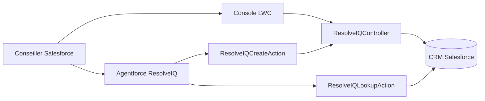

# ResolveIQ

**Une console Salesforce et un assistant Agentforce pour traiter les demandes de support client.**

ResolveIQ aide un conseiller à retrouver un client, consulter ses tickets, créer une demande et enregistrer sa résolution. L'agent s'appuie sur les données CRM et des actions Apex : il recherche les dossiers existants et demande confirmation avant de créer un ticket.

Projet développé en binôme avec un dépôt GitHub partagé et une Developer Org distincte par développeur.

## État du projet

Le MVP est déployé dans une première Developer Org. La console LWC, les services Apex et l'agent interne fonctionnent. La version 2 de l'agent masque les sorties JSON techniques et présente les tickets sous forme de tableau ou de liste.

| Fonctionnalité | État |
| --- | --- |
| Recherche de contacts par email exact | Implémentée |
| Consultation des tickets du contact | Implémentée |
| Création d'un ticket depuis la console | Implémentée |
| Clôture avec résolution obligatoire | Implémentée |
| Recherche CRM réelle via Agentforce | Vérifiée |
| Demande de confirmation avant création par l'agent | Vérifiée ; aucun ticket créé avant confirmation |
| Création par l'action Apex | Vérifiée par test Apex |
| Clic final de confirmation dans Agentforce Builder | À vérifier manuellement |
| Installation complète dans une deuxième org | À vérifier |

## Architecture



L'agent est destiné au **conseiller Salesforce authentifié**. La recherche par email sert à retrouver un dossier ; elle ne constitue pas une authentification du client externe.

### Stack

- Salesforce Platform et objets standards `Account`, `Contact`, `Case`.
- Apex, SOQL, opérations en mode utilisateur et classes `with sharing`.
- Lightning Web Components et composants Lightning standards.
- Agentforce Employee Agent, Agent Script et actions Apex invocables.
- Salesforce CLI, Visual Studio Code et GitHub.
- Version API du projet : **68.0**.

## Modèle de données

Un compte regroupe les contacts et tickets. Chaque ticket est lié à un contact et reprend son compte lorsque celui-ci est renseigné.

| Objet | Champ personnalisé | Usage |
| --- | --- | --- |
| Contact | `Preferred_Language__c` | `fr` ou `en` ; défaut `fr` |
| Case | `Category__c` | `Hardware`, `Software`, `Billing`, `Other` ; obligatoire |
| Case | `Resolution_Summary__c` | Résolution, 255 caractères maximum |
| Case | `AI_Summary__c` | Champ réservé à une évolution ; non alimenté automatiquement |

### Règles métier

- `ResolveIQ_Email_Required` : un contact doit avoir un email.
- `ResolveIQ_Required_Fields` : un ticket doit avoir un contact, un objet et une description.
- `ResolveIQ_Resolution_Required` : le statut `Closed` exige une résolution.
- La création Apex utilise `New`, l'origine `Web` et la priorité `Medium`.

Ces règles s'appliquent aussi aux modifications de dossiers déjà présents dans l'org. Vérifier la disponibilité des valeurs API `New`, `Working`, `Closed`, `Web` et `Medium` lors d'une installation dans une autre org.

## Structure du dépôt

```text
force-app/main/default/
├── applications/                 Application Lightning ResolveIQ
├── classes/                      Contrôleur, actions invocables et tests
├── lwc/resolveIQConsole/          Interface du conseiller
├── objects/                      Champs et règles de validation CRM
├── layouts/                      Présentations Contact et Case
├── permissionsets/               ResolveIQ_Developer
├── tabs/                         Onglet ResolveIQ
├── aiAuthoringBundles/           Agent Script maintenu comme source
├── aiAgents/                     Définition générée de l'agent
└── aiAgentDefinitionVersions/    Versions générées lors de la publication
manifest/resolveiq-core.xml        Déploiement CRM, Apex et console
scripts/apex/seedDemo.apex          Données fictives reproductibles
sfdx-project.json                  Configuration Salesforce DX
```

Les versions générées d'Agentforce sont conservées pour la traçabilité. Pour une nouvelle org, déployer le socle avec le manifeste puis **publier l'authoring bundle dans cette org**, plutôt que recopier les identifiants de versions générées ailleurs.

## Installation dans une Developer Org

### Prérequis

- Git et Salesforce CLI accessibles dans le terminal.
- Une Developer Org compatible avec les fonctionnalités Agentforce utilisées et Agentforce activé.
- Un utilisateur disposant des droits de configuration, de déploiement et de publication d'agents.
- VS Code avec Salesforce Extension Pack recommandé.
- Node.js/npm uniquement pour les outils locaux de lint, formatage et tests LWC.

L'accès à Agentforce et à ses services de génération dépend des fonctionnalités et quotas de l'org. Un déploiement CRM réussi ne garantit pas à lui seul l'accès à Agentforce.

### 1. Cloner et connecter son org

```powershell
git clone https://github.com/Marouanemounir/ResolveIQ.git
cd ResolveIQ
sf org login web --alias resolveiq-dev --set-default
```

`resolveiq-dev` est un alias local d'exemple. Utiliser son propre alias dans les commandes suivantes ; la première org du projet utilise `impactcare-dev`.

### 2. Déployer le socle

```powershell
sf project deploy start --manifest manifest/resolveiq-core.xml --target-org resolveiq-dev
sf org assign permset --name ResolveIQ_Developer --target-org resolveiq-dev
```

Dans **Setup → Object Manager → Contact / Case → Page Layouts → Page Layout Assignment**, affecter respectivement `ResolveIQ Contact` et `ResolveIQ Case` au profil et aux types d'enregistrement utilisés. Les affectations de profils ne sont pas déployées par le manifeste.

### 3. Charger les données de démonstration

```powershell
sf apex run --file scripts/apex/seedDemo.apex --target-org resolveiq-dev
```

Le script crée un compte `ResolveIQ Demo`, trois contacts et quatre tickets :

| Client | Email fictif | Langue | Tickets initiaux |
| --- | --- | --- | --- |
| Sara Demo | sara@example.com | fr | Matériel : New ; logiciel : Working |
| Yassine Demo | yassine@example.com | fr | Facturation : New |
| Emma Demo | emma@example.com | en | Logiciel : Closed, avec résolution |

Le script réutilise les enregistrements correspondants sans les modifier et s'arrête en cas d'ambiguïté. Il annule ses changements si une erreur survient. Les identifiants et numéros de tickets varient entre orgs. Les tests manuels peuvent ajouter d'autres tickets.

### 4. Publier et activer l'agent

Vérifier que `sf agent --help` expose les commandes Agentforce DX nécessaires, puis :

```powershell
sf agent validate authoring-bundle --api-name ResolveIQ_Agent --target-org resolveiq-dev
sf agent publish authoring-bundle --api-name ResolveIQ_Agent --target-org resolveiq-dev
sf agent activate --api-name ResolveIQ_Agent --target-org resolveiq-dev --json
sf org open agent --api-name ResolveIQ_Agent --target-org resolveiq-dev
```

Avec `--json` et sans numéro explicite, la commande d'activation sélectionne la dernière version publiée. Vérifier la version voulue avant une activation dans une org partagée.

La locale technique de l'agent est `en_US`, compatible avec la compilation vérifiée dans l'org initiale. Les instructions demandent des réponses en français.

## Utilisation

### Console du conseiller

Ouvrir Salesforce, puis **Lanceur d'applications → ResolveIQ → onglet ResolveIQ**.

1. Rechercher un email, par exemple `sara@example.com`.
2. Choisir le contact si plusieurs correspondent ; consulter ses tickets.
3. Saisir un objet, une description et une catégorie, puis créer le ticket.
4. Sélectionner un ticket ouvert, renseigner une résolution, puis le fermer.

### Agentforce

Dans **Agentforce Builder**, ouvrir l'aperçu de conversation de ResolveIQ. Utiliser le panneau de test de l'agent, pas l'assistant de développement du Builder.

Exemples :

> Recherche sara@example.com et montre ses tickets existants.

> Prépare un ticket pour Sara : objet « Souris défectueuse », description « La souris ne répond plus », catégorie Hardware. Attends ma confirmation.

Le premier message doit produire une réponse lisible avec les numéros, objets et statuts. Le second doit présenter un récapitulatif et demander confirmation avant l'écriture CRM. Les identifiants techniques et le JSON restent internes.

La clôture est effectuée dans la console. L'agent actuel ne possède pas d'action de clôture.

## Tests et validation

### Tests Apex

```powershell
sf apex run test --class-names ResolveIQControllerTest ResolveIQActionsTest --result-format human --wait 10 --target-org resolveiq-dev
```

Trois méthodes de test vérifient le parcours de création/clôture, les saisies invalides et les actions invocables. Les dernières exécutions dans l'org de développement sont réussies. Le contrôleur et les deux actions ont chacun atteint 100 % de couverture lors de leurs déploiements testés. La couverture ne remplace pas les tests fonctionnels et de permissions.

### Recette manuelle

| Vérification | Résultat attendu |
| --- | --- |
| Recherche Sara dans la console | Contact et tickets associés |
| Email absent du CRM | Message sans client inventé |
| Création sans objet ou description | Refus |
| Fermeture sans résolution | Refus |
| Fermeture avec résolution | Statut Closed |
| Recherche Sara avec l'agent | Données réelles, sans JSON brut |
| Préparation sans confirmation | Aucun ticket créé |
| Confirmation finale dans Builder | Un seul ticket créé, lié au bon contact |

La recherche en conditions réelles, le formatage et l'absence de création avant confirmation ont été vérifiés. Le clic final de confirmation dans Builder et la recette complète dans une deuxième org restent à exécuter.

Le projet contient les outils Jest du modèle Salesforce DX, mais **aucun test unitaire LWC n'est encore écrit**. `npm test` ne constitue donc pas actuellement une validation de l'interface.

## Permissions et limites

- Les classes Apex utilisent `with sharing` et le mode utilisateur pour respecter l'accès aux objets, champs et enregistrements.
- `ResolveIQ_Developer` accorde l'accès aux composants et les droits de lecture/création/modification CRM nécessaires, sans suppression ni accès global à tous les enregistrements.
- L'action de création exige une confirmation dans sa définition Agent Script.
- La recherche ne renvoie que les dossiers visibles par l'utilisateur ; les droits effectifs dépendent aussi de son profil et de ses autres autorisations.
- Le MVP a surtout été vérifié avec l'utilisateur de développement. Une recette avec un utilisateur aux droits restreints reste nécessaire.
- La console limite sa liste aux 100 tickets les plus récents du contact. L'action de recherche limite ses contacts et tickets à 200 résultats chacun ; elle ne propose pas de pagination.
- L'action invocable de création accepte au maximum 10 demandes par appel. La détection des doublons de tickets repose sur les instructions conversationnelles ; elle ne garantit pas l'idempotence d'une écriture répétée.
- `Asset`, garanties, emails entrants, Knowledge, SLA, résumé IA automatique et déploiement public ne font pas partie du MVP actuel.

## Collaboration et GitHub

Chaque développeur conserve sa propre org et ses propres authentifications. GitHub partage les fichiers ; les données CRM doivent être créées ou importées dans chaque org.

Pour une nouvelle fonctionnalité :

```powershell
git switch main
git pull --ff-only origin main
git switch -c feature/nom-fonctionnalite
# Modifier, déployer et tester dans son org.
git add force-app manifest scripts README.md
git commit -m "feat: describe the change"
git push -u origin feature/nom-fonctionnalite
```

Créer ensuite une Pull Request vers `main`, relire les différences et joindre les résultats de tests. Après fusion, l'autre développeur récupère `main`, déploie le socle dans son org et republie l'agent si son script a changé.

Les dossiers d'authentification `.sf/`, `.sfdx/`, les dépendances et les journaux sont ignorés. Ne pas ajouter de jetons, de fichiers de session ou de transcriptions contenant des données réelles au dépôt.

## Dépannage

| Symptôme | Vérification |
| --- | --- |
| `sf` non reconnu | Installation Salesforce CLI et ouverture d'un nouveau terminal |
| Application absente | Déploiement, affectation du permission set et nouvelle session Salesforce |
| Champ absent | Permissions de champ et affectation de la présentation |
| JSON brut après mise à jour | Version active, nouvelle conversation ; sorties `is_displayable: False`, `filter_from_agent: False` |
| Agent annoncé actif mais ancienne réponse | Actualiser Builder et ouvrir la dernière version active |
| Erreur lors de création/clôture | Champs requis, valeurs API des listes et permissions de l'utilisateur |

## Prochaines étapes

1. Terminer la recette de confirmation dans Builder et l'installation dans la deuxième org.
2. Ajouter tests LWC, tests de permissions et contrôles automatisés GitHub.
3. Renforcer la prévention des doubles créations et la pagination.
4. Préparer une démonstration courte : recherche client → tickets existants → confirmation → création → résolution dans la console.

## Documentation officielle

- [Salesforce CLI](https://developer.salesforce.com/tools/salesforcecli)
- [Lightning Web Components](https://developer.salesforce.com/docs/platform/lwc/overview)
- [Opérations Apex en mode utilisateur](https://developer.salesforce.com/blogs/2023/05/write-simplified-and-secure-apex-with-spring-23-updates)
- [Développer un agent avec Agentforce DX](https://developer.salesforce.com/docs/ai/agentforce/guide/agent-dx-nga-author-agent.html)
- [Actions Agent Script](https://developer.salesforce.com/docs/ai/agentforce/guide/ascript-ref-actions.html)
